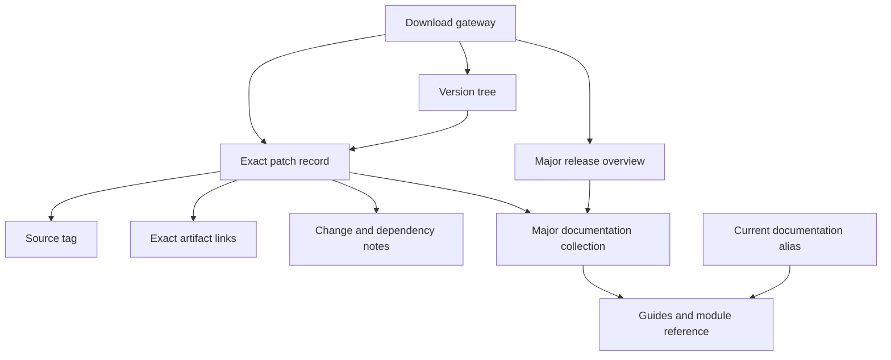

# erlang.org: Information Architecture Investigation

**Investigation date:** 8 October 2026  
**Context:** Preparation for LFE compatibility, distribution, documentation, and website discussions  
**Status:** Evidence record and assessment; no implementation decisions or execution plan

## 1. Principal findings

The useful Erlang precedent is a set of relationships: a release has an identity, downloadable artifacts, release notes, source provenance, documentation, and a place in a version history. These relationships are more useful to LFE than simply copying the site's navigation or appearance.

The investigation found:

1. **A compact public gateway over several distinct systems.** Eight global navigation destinations lead into release records, resource directories, chronological publications, security reporting, and proposals. Generated documentation and historical archives have their own structures. [S01–S09]
2. **Release and patch pages are substantial content objects.** They connect distribution choices to source tags, dates, application changes, and incompatibility notes. The version tree adds containment and advisory relationships. [S10–S16]
3. **Documentation is versioned, but the selected patch and online documentation are not necessarily the same snapshot.** A patch's online documentation link can target its major-version collection. Exact artifact links and moving documentation collections need separate interpretation. [S13, S16–S18]
4. **Learning material is spread across several destinations.** Books are on the documentation resource page; courses, videos, tutorials, and tools are mostly under Community. There are no separate Books or Videos entries in the global navigation. [S01, S03, S04]
5. **The reference site has maintenance defects of its own.** The FAQ retains obsolete version and licensing answers; the documentation resource page misidentifies a linked free book. These are verified content problems, not general impressions. [S03, S27–S30]

**Assessment:** Harmonising LFE with Erlang can mean adopting familiar concepts and preserving useful relationships while making LFE-specific compatibility choices clearer. This report supplies evidence for that discussion; it does not select a branch convention, support policy, packaging format, or new LFE site structure.

## 2. Scope, method, and confidence

### 2.1 What was investigated

The scope is a structural IA inventory: global sections, page families, local hierarchies, navigation labels, resource groupings, release and documentation relationships, external handoffs, and representative task journeys.

Public pages and official source documentation were read. The home page's HTML was also inspected for navigation and footer destinations. All thirteen major-release overview pages from OTP 17 through OTP 29 were opened. Patch pages and documentation generations were sampled deliberately. The public website repository's README and Jekyll configuration were inspected to explain content collections and generation. [S01, S10–S26, S34–S35]

This is **not an exhaustive census of every URL**, nor a review of every module reference, news article, proposal, archive message, or binary. It is an inventory of the discovered architecture with representative content verification. Undiscovered orphan pages remain possible.

### 2.2 Evidence labels

| Label | Meaning |
|---|---|
| Observed | A page, link destination, document, or source definition was retrieved and inspected. |
| Source-declared | The official repository or a page describes a mechanism; deployment or interaction was not independently exercised. |
| Assessment | An interpretation of evidence and its likely consequence. |
| Candidate lesson | A possible implication for LFE; not an adopted decision. |
| Unverified | Retrieval or interaction did not establish the claim. |

Sources are identified as S01, S02, etc. The source register provides portable URLs. URL patterns such as `/patches/OTP-{version}` describe observed families; they do not assert that every conceivable expansion exists.

### 2.3 Coverage register

| Area | Coverage achieved | Limit |
|---|---|---|
| Public gateway | Home plus all eight global destinations; header and footer inspected on home | No device-by-device layout audit |
| Release overviews | OTP 17–29 inclusive: thirteen pages | Artifact availability was not tested for every version |
| Patch records | OTP 29.1.1, 26.2.5.21, and 17.0.1 read | No complete patch-by-patch census; OTP 24.1 retrieval failed |
| Version tree | Introductory text, documented data sources, URL selection pattern | JavaScript expansion, search results, and advisory calculations were not exercised |
| Documentation | Current portal, machine-readable contents, guides, module index and a compiler module; historical OTP 17, 26, and 27 samples; OTP 29 collection identity | No per-module audit; some portal bodies were unavailable to text extraction |
| News | Index inspected across current and historical entries; current release and site migration articles read | Individual articles sampled |
| Blog | Chronological index and OTP 29 highlights article read | No article-by-article content review |
| Enhancement proposals | Process page, proposal registry, EEP 59 example | No proposal-by-proposal review |
| Community and archives | Resource groupings, workshops index, workshop 2019 example, three mailing-list archive roots | No complete event or message archive crawl |
| FAQ and publications | FAQ contents and acquisition chapter; linked free-book PDF identity | No full FAQ or publication accuracy audit |
| Website source | Public README and configuration | No pinned repository checkout or build reproduction |

### 2.4 Retrieval limitations

Text retrieval sometimes omits page chrome and JavaScript content. A missing section in extracted text is not proof that users cannot see it. The release navigation was visible in an older patch-page extraction even when omitted from newer page extractions.

Retrieval caches also returned different patch labels for some aliases. For example, `/docs/29/` initially yielded a title containing 29.0.5, while `/docs/29/index.html` yielded 29.1.1. That discrepancy is recorded as a retrieval qualification, **not a confirmed live-site defect**. [S17–S18]

The sitemap and robots files could not be read through the research interface. Some GitHub files, an enhancement-proposal alias, the legacy search route, and the linked thesis were also unavailable. No complete crawl, orphan analysis, or site-wide broken-link rate is claimed.

## 3. Global navigation and public gateway

### 3.1 Navigation inventory

The following order and labels were observed in the home-page HTML. The logo links to the home page. [S01]

| Position | Display label | Destination | Principal role |
|---|---|---|---|
| Home control | Erlang logo | `/` | Return to the public gateway |
| 1 | Download | `/downloads` | Obtain Erlang/OTP and find installation options |
| 2 | Documentation | `/docs` | Curated entry points into documentation and publications |
| 3 | Community | `/community` | Participation, learning, tools, and ecosystem resources |
| 4 | News | `/news` | Announcements and historical notices |
| 5 | Blog | `/blog` | Technical explanations and development commentary |
| 6 | Security | `/security` | Vulnerability reporting procedure |
| 7 | EEP | `/eep` | Language and library enhancement process |
| 8 | About | `/about` | Project background, site source, and licensing |

**Observation:** `/docs` resolves to the resource page at `/docs.html`. It is distinct from `/doc/`, the current generated documentation portal. [S03, S19]

**Assessment:** The singular/plural path distinction encodes two different kinds of destination, but the path spelling alone gives users little explanation of that distinction.

### 3.2 Home-page roles

The home page introduces the language through short code examples, offers a prominent download action, explains Erlang and OTP separately, routes readers to introductory guides, and displays recent announcements. Participation leads to the Erlang Ecosystem Foundation. [S01]

The footer inspected on home provides download and OTP-repository shortcuts and a theme control. Its theme logic refers to the documentation settings stored by ExDoc. This is an observed implementation connection, not proof that every page or device has a seamless visual experience.

**Assessment:** Home acts as a gateway rather than a comprehensive resource catalogue. That is a useful role distinction for LFE's front-page discussion.

## 4. Structural inventory by page family

| Family | Observed route or example | Organisation | Key relationships | Evidence |
|---|---|---|---|---|
| Public home | `/` | Introductory sections and featured announcements | Downloads, introductory guides, participation | S01 |
| Acquisition landing | `/downloads` | Source builds, package options, current artifacts | Latest patch, release overview, installation guide, version tree | S02 |
| Major-release overview | `/downloads/29`; OTP 17–29 inspected | One overview per major release | Highlights, notes, artifacts, major documentation collection | S10–S12; S20–S26 |
| Patch record | `/patches/OTP-29.1.1` | One record per exact version | Tag, date, changed applications, issue references, artifacts | S13–S15 |
| Version relationship explorer | `/versions`; `/versions?v=29.1.1` | Release tree with selection and search controls | Release containment, support, advisories | S16 |
| Documentation resource directory | `/docs.html` | Technical references, books, paper, FAQ | Generated docs and external publications | S03 |
| Current generated docs | `/doc/` | System guides and application collections | Reference modules, policy, search, source, alternate formats | S19, S31–S33 |
| Historical generated docs | `/docs/26/`; `/docs/27/readme.html` | Major-version collections; older and newer documentation systems | Guides and reference for an older OTP family | S18, S36–S39 |
| System-guide chapter | `/doc/system/install.html` | Guide sections and sequential chapters | Other guides, reference modules, contribution information | S40–S43 |
| Application documentation | `/doc/apps/stdlib/index.html` | Application collection | Application guides and module references | S44 |
| Module reference | `/doc/apps/compiler/compile.html` | Overview, types, function summaries, detailed entries | Other modules and source | S45 |
| News archive and article | `/news`; `/news/191` | Reverse chronology; numbered article routes | Release and community announcements | S05, S46 |
| Blog archive and article | `/blog`; `/blog/highlights-otp-29/` | Reverse chronology; descriptive slugs | Guides, proposals, release notes, source discussions | S06, S47 |
| Community directory | `/community` | Subject groupings | External services and internal archives | S04 |
| Workshops index | `/community/workshops.html` | Yearly entries | Historical hosted pages and external conference sites | S48 |
| Hosted workshop archive | `https://erlang.org/workshop/2019/` | Standalone event page | Programme and event information | S49 |
| Mailing-list archives | `https://erlang.org/pipermail/{list}/` | List roots with dated archive entries | Historical discussion and announcement records | S50–S52 |
| Security reporting | `/security` | Reporting instructions | OTP repository security reporting and issue references | S07 |
| Enhancement process | `/eep` | Rationale and editorial procedure | Registry, guidelines, source repository, discussion | S08 |
| Proposal registry | `/eeps.html` | Table of proposal numbers, status codes, titles | Individual EEP pages and status legend | S53 |
| Individual proposal | `/eeps/eep-0059` | Proposal metadata and structured argument | Implementation rationale and related proposals | S54 |
| About | `/about` | Project, site, and licence background | Website repository and implementation tools | S09 |
| FAQ | `/faq/faq.html`; `/faq/obtaining.html` | Chapter hierarchy and question anchors | Reference, acquisition, tools, historical material | S27–S28 |
| File archive | `https://erlang.org/download/` | Server directory listing | Source and documentation files, notes, checksums, subdirectories | S55 |
| Hosted publication | `/download/erlang-book-part1.pdf` | Standalone PDF | Linked from the resource directory and FAQ | S29 |
| Historical licence text | `/EPLICENSE` | Standalone text | Relevant to older OTP releases; incorrectly presented as current in the FAQ | S30 |
| Syndication | `/news.xml`; `/blog.xml` | Separate feeds defined in site configuration | News and blog collections | S35; bodies not inspected |

The file archive visibly includes older files and directories for contributions, miscellaneous material, patches, snapshots, testing, and vulnerability information. Those directories were inventoried as entrances, not recursively audited. [S55]

### 4.1 Structural relationship diagram

This diagram concentrates on release selection and documentation identity, rather than repeating the global navigation list.

The distinction between exact artifacts and major documentation collections is observable. The diagram does not imply that a major documentation collection is immutable. [S02, S13, S16–S19]

## 5. Releases, downloads, and installation

### 5.1 Release hierarchy

The release architecture distinguishes a major-family overview from exact version records. An extracted release navigation lists major families with highlights and individual versions beneath them. The inspected families run from OTP 17 to OTP 29. [S10–S15, S20–S26]

Major overviews are editorial explanations of a release family's changes. Patch pages add structured identity and detailed change information. An overview therefore serves a different purpose from a patch record, even though both offer downloads.

The thirteen observed overview URLs are:

| OTP | Overview | OTP | Overview |
|---|---|---|---|
| 17 | [17](https://www.erlang.org/downloads/17) | 24 | [24](https://www.erlang.org/downloads/24) |
| 18 | [18](https://www.erlang.org/downloads/18) | 25 | [25](https://www.erlang.org/downloads/25) |
| 19 | [19](https://www.erlang.org/downloads/19) | 26 | [26](https://www.erlang.org/downloads/26) |
| 20 | [20](https://www.erlang.org/downloads/20) | 27 | [27](https://www.erlang.org/downloads/27) |
| 21 | [21](https://www.erlang.org/downloads/21) | 28 | [28](https://www.erlang.org/downloads/28) |
| 22 | [22](https://www.erlang.org/downloads/22) | 29 | [29](https://www.erlang.org/downloads/29) |
| 23 | [23](https://www.erlang.org/downloads/23) | | |

### 5.2 Download choices

The acquisition landing distinguishes source compilation from packaged installation. It supplies package-manager examples and points users needing a particular version toward a source build. Current source, Windows, release-note, and documentation artifact links lead to GitHub. [S02]

Major and patch pages also link to third-party version/build tools, an external package provider, and Docker. An exact patch page illustrates an exact Docker tag, while an overview illustrates a major tag. These are different degrees of version selection. Links and command examples were observed; the availability of every historical tag or third-party package was not verified. [S10, S13–S15]

The artifact choices vary historically. Older major pages can show fewer actionable artifact links. The inspected OTP 29 overview offers 64-bit Windows choices; the OTP 26 and 27 overviews also offer 32-bit choices. The generic layout is therefore not evidence of a uniform artifact matrix. [S10–S12]

### 5.3 Patch-record content model

The OTP 29.1.1 and OTP 26.2.5.21 pages expose the following information. This is an inventory of Erlang's presentation, not a proposed LFE schema. [S13–S14]

| Information | Role |
|---|---|
| Exact OTP version | Identifies the release being discussed |
| Git tag link | Connects the record to source provenance |
| Date | Places the release in time |
| Major release | Associates it with its release family |
| Changed application versions | Identifies affected OTP components |
| Issue references | Connects changes to tracked work and advisories |
| Incompatibility section | Makes potentially disruptive changes findable |
| Per-application notes | Explains the changes at component level |
| Runtime dependencies | Qualifies independent patch application |
| Version-tree link | Explores which versions contain the selected release |
| Artifact and documentation links | Connects identity to distribution and reference material |

**Assessment:** This is a strong precedent for making LFE release information independently addressable and reviewable. It does not demonstrate a build-versus-runtime compatibility matrix for an LFE artifact.

### 5.4 Version tree and data provenance

The version explorer documents its sources: the OTP application-version table, Git tag dates, repository security advisories, CVE records, and supplementary vulnerability data. It describes how release numbers establish branch relationships and explains the handling of unknown advisory applicability. It requires JavaScript and points readers to download pages for per-release information. [S16]

**Assessment:** Its value to this project is the explicit connection between structured data and user-facing explanations. The tree itself is a candidate mechanism, not something LFE necessarily needs.

No claim is made that containment proves arbitrary compiled-artifact compatibility. Those are different relationships.

### 5.5 Installation pathways

The detailed installation material lives within system documentation rather than in an isolated top-level installation section. Its entrance separates Unix builds, cross-compilation, Windows builds, and patching; it sends people back to Downloads to consider prebuilts. [S40–S41]

**Assessment:** The two-way link between obtaining software and installing it is useful. For LFE, an installation instruction would also need to explain the prerequisite OTP environment and the compatibility claim of the chosen LFE artifact.

## 6. Documentation architecture

### 6.1 Resource page versus generated reference

The public documentation resource page combines technical entry points with books, a thesis link, a FAQ, and an external security resource. It is a curated directory rather than the complete documentation hierarchy. [S03]

The generated portal supplies a different organisation: system guides, application collections, a module index, and lifecycle reference pages. Current pages identify their OTP version; module pages also identify their application version. [S19, S31–S33, S45]

### 6.2 Current documentation hierarchy

The current portal's machine-readable table of contents identifies seven application groups. Counting the listed application entries gives **36 applications in that retrieved contents file**. This is a count of the documentation navigation entries, not a statement about all applications that can exist in an Erlang installation. [S31]

| Application group | Listed entries |
|---|---:|
| Core | 5 |
| Database | 2 |
| Operations and maintenance | 2 |
| Interfaces and communication | 15 |
| Tools | 9 |
| Test | 2 |
| Documentation | 1 |
| **Total** | **36** |

System material covers installation, introductory programming, system operation, OTP application design, examples, the language reference, efficiency, interoperability, embedded systems, and security/supply-chain information. The system collection's own contents file makes chapters and their guide groupings explicit. [S31–S32]

**Assessment:** Generated contents can be valuable IA evidence. They expose a hierarchy that prose extraction from a landing page may omit, and can support later consistency checks.

### 6.3 Documentation page patterns

| Pattern | Observed characteristics | Evidence |
|---|---|---|
| Portal-level page | Version identity, cross-application reference entrances, documentation-wide search affordance | S19, S31, S33 |
| Guide chapter | Guide context, sections, related references, previous/next page links | S40–S43 |
| Module reference | Module description, types, functions, detailed signatures, links into other modules | S45 |
| Lifecycle index | Changes grouped by OTP release with links into affected reference material | S56–S57 |
| Machine-readable contents | Navigable text representation of collections and pages | S31–S32 |

Current inspected ExDoc pages expose source and Markdown actions, search controls, settings, and links to text-oriented contents. System-guide pages also offer an ePub entrance. These affordances were observed, but their interactive behaviour and search quality were not tested. [S19, S40–S43]

### 6.4 Documentation generations and aliases

OTP 27's release overview states that the documentation system changed. Historical OTP 26 material retains the older manual organisation, while the inspected OTP 27 and current material use ExDoc. [S11, S36–S38]

| Link or route | Observed result | Interpretation |
|---|---|---|
| `/doc/getting_started/intro.html` | Resolves to `/doc/system/getting_started.html` | Older guide entrance remains usable in the current system |
| `/doc/design_principles/des_princ.html` | Resolves to `/doc/system/design_principles.html` | Another preserved guide entrance |
| `/doc/man/compile.html` | Resolves to `/doc/apps/compiler/compile.html` | Older module path maps to the newer application hierarchy |
| `/docs/26/man/compile.html` | Older manual page remains available | Historical reference retains its documentation generation |
| Patch 29.1.1 → online documentation | Targets `/docs/29/` | Major collection, rather than a patch-number URL |

Evidence: S01, S13, S17–S18, S39, S45. The alias/title cache discrepancy described in §2.4 remains a separate qualification.

**Assessment:** Stable link migration and explicit version context are valuable precedents. A major collection is useful for routine reference, but LFE should decide explicitly whether an exact artifact also needs immutable documentation.

## 7. Community, learning, publications, and archives

The Community page has nine broad groupings covering contribution, discussions, mailing archives, other resources, editors, learning, events, ecosystem applications, and research. Contribution guidance also distinguishes ordinary issues from security disclosures. [S04]

Learning resources include courses, video playlists, tutorials, exercises, and operational guidance. Their placement under Community means the label serves both participation and education. [S04]

Books have multiple entrances: the public documentation directory, generated documentation introductions, the Community learning resources, and the FAQ. This can support multiple journeys, but it creates multiple editorial locations to maintain. [S03, S04, S19, S28]

The Workshops index combines internally hosted historical material with external event sites. Mailing lists lead to separately presented archive roots. These are part of the broader information estate even though they do not share the primary gateway's page pattern. [S48–S52]

**Assessment:** A resource can reasonably have several entrances while retaining one authoritative metadata record. Separate Books and Videos sections would be an LFE choice; they would not reproduce Erlang's current global navigation.

## 8. News, blog, proposals, security, and governance

News and Blog are separate chronological collections. News carries announcements, release notices, operational notices, and community events. Blog provides longer technical explanation, with descriptive article URLs and links to relevant references. [S05–S06, S46–S47]

The inspected News index reaches back to 2009. Its extracted index contains 150 article entries, numbered by the retrieval interface from 0 through 149. That is a count of entries in the observed index, not a census of all historical news URLs. [S05]

EEP material separates the process introduction from a registry and individual proposals. The observed registry contains 80 linked rows, with proposal status codes and a legend. EEP 59 provides a relevant example of documenting a change to the documentation system. [S08, S53–S54]

Security's top-level destination primarily explains reporting. Support information, vulnerability status, and secure development guidance have other entrances in the repository, version explorer, and documentation. [S07, S16, S32, S58]

**Assessment:** These are different user tasks. A reporting page, a support-policy page, and an advisory catalogue should be identifiable as such, even when related.

## 9. External handoffs

This table records important classes of outgoing destination. It is not an audit of every external link's availability.

| Destination | Role in the observed architecture | Evidence |
|---|---|---|
| `github.com/erlang/otp` | Source, tags, releases, artifacts, issues, contribution guidance, security | S02, S04, S07, S13, S59 |
| `github.com/erlang/erlang-org` | Website source and maintenance | S09, S34–S35 |
| `github.com/erlang/eep` | Proposal source repository | S08 |
| `hub.docker.com` | Container distribution | S10, S13 |
| Erlang Solutions | External package distribution | S10, S13 |
| kerl, asdf, mise project sites | Build and version-management tools | S02 |
| `erlef.org` | Foundation participation and chat invitations | S01, S04 |
| `security.erlef.org` | Secure coding and deployment guidance | S03 |
| Erlang Forums; Slack; IRC; Stack Overflow | Discussion and help | S04 |
| Book publishers | Paid editions and publication information | S03 |
| YouTube and educational sites | Courses and videos | S04 |
| Editor/language-server projects | Development environment support | S04 |
| Hex, build-tool sites, application projects | Ecosystem package and tooling resources | S04 |
| Conference and research sites | Events and research context | S04, S48 |
| GitHub advisories and CVE records | Vulnerability provenance | S16 |

**Assessment:** The website is a router into an ecosystem, not the sole host of every resource. LFE's later content inventory should therefore record both ownership and destination: “listed on lfe.io” and “maintained by LFE” are not interchangeable.

## 10. Task journeys traced from evidence

These are analytical link traces, not usability-test results. They establish available routes, not completion times or user success rates.

| User task | Traced route | What works | Qualification | Evidence |
|---|---|---|---|---|
| Obtain the current OTP | Home → Downloads → current patch/artifact | Acquisition has a clear gateway | Package-manager installations may lag or choose a different version | S01–S02, S13 |
| Choose an older release | Release navigation or version tree → major overview/patch | History has dedicated records | No evidence that every offered third-party mechanism serves every old version | S10–S16 |
| Build a chosen release | Download record → source; installation reference | Source and detailed instructions have identifiable homes | User must preserve version context when following current guide aliases | S02, S40–S41 |
| Read documentation for an installed major | Release/patch → `/docs/{major}/` → guide/module | Major-version reference is available | Online collection need not be an immutable exact-patch snapshot | S13, S17–S18, S36–S39 |
| Understand a patch before adopting it | Patch record → incompatibilities/application changes → issues | Structured identity and change explanations | Dependency notes and general support policy have different scopes | S13–S14 |
| Learn the language or OTP style | Home → introductory language or OTP guide | Two introductory needs have separate entrances | Other learning formats are spread across resource directories | S01, S03–S04, S42–S43 |
| Find a particular API | Generated docs → module index → module reference | Name, application, and version context are available | Search affordances seen; search effectiveness unmeasured | S33, S45 |
| Get help or contribute | Community → discussion or contribution destination | Tasks are grouped and directed outward | Resources and history add breadth to an already large directory | S04 |
| Propose a language change | EEP introduction → registry → guideline/proposal → repository/discussion | Process and precedent are explicit | Editorial process text itself needs periodic validation | S08, S53–S54 |
| Report a vulnerability | Security or Community → private reporting instructions | Clear separation from ordinary public issues | Support and advisory discovery are elsewhere | S04, S07, S16, S58 |

## 11. Assessment register

Priority here describes likely user consequence, not an implementation order. Findings are not assigned numerical scores without measurements.

| ID | Evidence or observation | Assessment and consequence | Confidence | Significance for LFE |
|---|---|---|---|---|
| F01 | Eight global destinations with task-oriented acquisition and documentation entrances | Compact gateway provides a useful orientation layer | High: observed HTML | Useful reference for front-page scope |
| F02 | Major overviews and exact patch records are separate | Supports both broad understanding and precise selection | High: multiple families inspected | Strong release-information precedent |
| F03 | Patch record connects tag, notes, artifacts, applications, and dependencies | Release identity becomes inspectable rather than implied by a filename | High | Strong distribution precedent |
| F04 | Online docs from patch 29.1.1 target `/docs/29/` | Exact artifact identity and documentation collection identity differ | High for URL; moving-content implications are assessment | High for reproducibility and troubleshooting |
| F05 | Downloads warns about package-manager version lag | Acquisition channel can change the version actually installed | High | Downloads need a way to verify the installed environment |
| F06 | Community combines learning, tools, contribution, research, and events | A broad directory may impose classification effort on newcomers | High for grouping; user difficulty untested | Candidate for clearer LFE resource entrances |
| F07 | Books have several editorial entrances | Duplicate descriptions can drift while multiple entrances remain useful | High for duplication; maintenance burden inferred | Candidate for shared resource metadata |
| F08 | FAQ acquisition chapter names OTP 19.3 as current | A reader can receive obsolete release information from an official linked resource | High: directly read and compared with current Downloads | High: prevent stale evergreen answers |
| F09 | FAQ describes the older licence as current; About distinguishes OTP 18 onward | Licence guidance conflicts across linked resources | High: both pages read | High: authoritative policy needs a clear source |
| F10 | Free-book label in Docs identifies Armstrong's later book; destination PDF identifies a different, coauthored book | A reader obtains a different work from the one promised | High: label and PDF front matter read | High for resource metadata accuracy |
| F11 | Old and new documentation structures coexist; older URLs redirect | Migration can retain external links while presenting newer structure | High for sampled routes | Strong precedent; not a complete redirect audit |
| F12 | Version tree declares JavaScript dependence and explanatory data provenance | Powerful relationship view has an interaction dependency | High for declared mechanism; behaviour untested | Candidate requiring fallback and accuracy validation |
| F13 | Security policy and system guide discuss different support/compatibility scopes | Users must distinguish security maintenance, routine fixes, and compiled-code loading | High for texts; confusion inferred | High for LFE policy wording |
| F14 | Raw download, mailing-list, workshop, and FAQ surfaces coexist with the gateway | Historical preservation extends beyond a unified presentation | High for entrances; breadth not exhaustively counted | Treat archival context explicitly |

### 11.1 Confirmed resource metadata defects

**FAQ:** The acquisition chapter's answer about the current release still gives OTP 19.3 and March 2017, while Downloads identifies 29.1.1. The same chapter presents the older Erlang licence as the general current licence; About says Apache 2.0 applies from OTP 18 onward. A recent date on the FAQ cover does not establish that each answer was reviewed. [S02, S09, S27–S28]

**Free book:** The documentation resource directory labels its limited free edition as *Programming Erlang: Software for a Concurrent World*. The linked PDF's opening pages identify *Concurrent Programming in Erlang*, second edition, with Armstrong, Virding, Wikström, and Williams as authors. This is a mismatched label and destination. [S03, S29]

Neither finding implies that the entire resource is useless. Both show why content validation must examine the actual item and its claim, not just whether the URL responds.

### 11.2 Support and compatibility: a relevant distinction

The system guide discusses ordinary fixes primarily on the newest release and separately documents compiled-code loading into subsequent releases. The repository security policy states a three-release maintenance/security window; the version tree derives support labelling from that policy. These are different scopes, and are not automatically a contradiction. [S16, S42, S58]

For the user's reported build/runtime issue, the particularly relevant documented distinction is direction: the compatibility guide describes loading compiled code on at least two later releases and says loading it on earlier releases is unsupported. It also recommends compiling for the deployed release for performance. [S42]

That is background evidence, **not a diagnosis of the reported LFE stacktrace**. LFE's compiler interfaces, generated code, APIs, dependencies, and particular failure still require their own evidence. The compiler reference has a dedicated discussion of language implementations on BEAM, which is a useful later reference for Robert's work. [S45]

## 12. Candidate lessons for LFE

The following are discussion inputs. They do not assign work or commit the project to an implementation.

| Candidate | Erlang evidence behind it | LFE-specific question still open |
|---|---|---|
| Treat releases as durable information objects | Major and patch record architecture | What identifies an LFE release, compatibility snapshot, and built artifact? |
| Link selection to installation and reference | Acquisition and documentation journeys | Which LFE/OTP combinations are offered, and how are prerequisites communicated? |
| Distinguish source release, build environment, runtime promise, and test evidence | Exact tags, dependency notes, and compatibility policy | Which claims can LFE make and validate independently? |
| Preserve exact identity where reproducibility matters | Patch-specific tags/artifacts versus major docs | Does each artifact need immutable docs and a validation record? |
| Derive repeated release information from shared data | Website source describes generated patch data; version tree declares provenance | Where should the authoritative metadata live, and which views consume it? |
| Keep the front page focused on entrances | Home acts as a gateway | Which immediate tasks and identity cues matter most for LFE? |
| Make learning formats deliberate | Books and videos currently have different Erlang entrances | Should LFE have separate sections, a shared learning hub, or both? |
| Separate present guidance from historical preservation | FAQ, hosted events, archives, and old manuals | What is maintained, archival, superseded, or retired? |
| Validate resource identity as well as URLs | Confirmed book-label mismatch | What metadata should a book, video, or guide carry? |
| Preserve old links through structural changes | Sampled documentation redirects | Which existing LFE links must survive migration? |
| Explain support at the point of selection | Support definitions are distributed | What should a user see before choosing an older LFE combination? |
| Evaluate interactions separately from the hierarchy | Tree and documentation search affordances | What experiments will establish selection and navigation usability? |

Books, videos, design-system evolution, and LFE runtime protections remain in their previously recorded scope. This investigation does not assess lfe.io or the billosys design work, and does not move compiler implementation into the website track.

## 13. Questions this investigation does not resolve

1. Which LFE source and precompiled-artifact combinations actually work with which OTP build/runtime versions?
2. What support promises should LFE attach to preserved snapshots or old artifacts?
3. Which proposed branch/tag names best communicate those promises?
4. Which historical LFE content has enough value to retain, rewrite, or archive?
5. How should LFE documentation versions align with source releases and artifact builds?
6. How usable are Erlang's version-tree and search interactions on desktop, mobile, keyboard, and assistive technology?
7. What URLs are orphaned or broken across the complete Erlang information estate?
8. Which source repository state generated the precise deployed snapshot? The inspected repository was not pinned to a deployment commit.

These are explicit boundaries on this evidence record, not reasons to postpone using its findings.

## 14. Source register

Sources were inspected during this investigation on 8 October 2026. Some retrievals used cached page representations; §2.4 describes the resulting qualifications. URLs below are the evidence destinations, not guarantees that an alias will retain the same contents indefinitely.

| ID | Source | URL |
|---|---|---|
| S01 | Home; header/footer HTML | https://www.erlang.org/ |
| S02 | Downloads | https://www.erlang.org/downloads |
| S03 | Documentation resource directory | https://www.erlang.org/docs.html |
| S04 | Community | https://www.erlang.org/community |
| S05 | News index, including historical entries | https://www.erlang.org/news |
| S06 | Blog index | https://www.erlang.org/blog |
| S07 | Security reporting | https://www.erlang.org/security |
| S08 | Enhancement process | https://www.erlang.org/eep |
| S09 | About | https://www.erlang.org/about |
| S10 | OTP 29 overview | https://www.erlang.org/downloads/29 |
| S11 | OTP 27 overview | https://www.erlang.org/downloads/27 |
| S12 | OTP 26 overview | https://www.erlang.org/downloads/26 |
| S13 | OTP 29.1.1 patch record | https://www.erlang.org/patches/OTP-29.1.1 |
| S14 | OTP 26.2.5.21 patch record | https://www.erlang.org/patches/OTP-26.2.5.21 |
| S15 | OTP 17.0.1 patch record; extracted release navigation | https://www.erlang.org/patches/OTP-17.0.1 |
| S16 | Version tree and its provenance explanation | https://www.erlang.org/versions |
| S17 | OTP 29 documentation collection alias | https://www.erlang.org/docs/29/ |
| S18 | OTP 29 documentation index | https://www.erlang.org/docs/29/index.html |
| S19 | Current documentation introduction | https://www.erlang.org/doc/readme.html |
| S20 | OTP 17 overview | https://www.erlang.org/downloads/17 |
| S21 | OTP 18 overview | https://www.erlang.org/downloads/18 |
| S22 | OTP 19 overview | https://www.erlang.org/downloads/19 |
| S23 | OTP 20 overview | https://www.erlang.org/downloads/20 |
| S24 | OTP 21 overview | https://www.erlang.org/downloads/21 |
| S25 | OTP 22 overview | https://www.erlang.org/downloads/22 |
| S26 | OTP 23, 24, 25, and 28 overviews | https://www.erlang.org/downloads/23 ; https://www.erlang.org/downloads/24 ; https://www.erlang.org/downloads/25 ; https://www.erlang.org/downloads/28 |
| S27 | FAQ contents and cover date | https://www.erlang.org/faq/faq.html |
| S28 | FAQ acquisition chapter | https://www.erlang.org/faq/obtaining.html |
| S29 | Linked free-book PDF; opening pages identify the work | https://erlang.org/download/erlang-book-part1.pdf |
| S30 | Historical Erlang licence | https://www.erlang.org/EPLICENSE |
| S31 | Current portal machine-readable contents | https://www.erlang.org/doc/llms.txt |
| S32 | System documentation machine-readable contents | https://www.erlang.org/doc/system/llms.txt |
| S33 | Module index | https://www.erlang.org/doc/man_index.html |
| S34 | Website repository README | https://github.com/erlang/erlang-org |
| S35 | Website content collections and feeds | https://github.com/erlang/erlang-org/blob/master/_config.yml |
| S36 | OTP 17 documentation root | https://www.erlang.org/docs/17/ |
| S37 | OTP 26 documentation index | https://www.erlang.org/docs/26/index.html |
| S38 | OTP 27 documentation introduction | https://www.erlang.org/docs/27/readme.html |
| S39 | Older compiler manual | https://www.erlang.org/docs/26/man/compile.html |
| S40 | Installation guide introduction | https://www.erlang.org/doc/system/installation_guide.html |
| S41 | Building and installation chapter | https://www.erlang.org/doc/system/install.html |
| S42 | Support and compatibility guide | https://www.erlang.org/doc/system/misc.html |
| S43 | Introductory guides and observed redirects | https://www.erlang.org/doc/getting_started/intro.html ; https://www.erlang.org/doc/design_principles/des_princ.html |
| S44 | Standard library collection entrance | https://www.erlang.org/doc/apps/stdlib/index.html |
| S45 | Current compiler reference and legacy alias | https://www.erlang.org/doc/apps/compiler/compile.html ; https://www.erlang.org/doc/man/compile.html |
| S46 | OTP 29.1 announcement | https://www.erlang.org/news/191 |
| S47 | OTP 29 highlights blog article | https://www.erlang.org/blog/highlights-otp-29/ |
| S48 | Workshops index | https://www.erlang.org/community/workshops.html |
| S49 | Hosted 2019 workshop | https://erlang.org/workshop/2019/ |
| S50 | Questions archive root | https://erlang.org/pipermail/erlang-questions/ |
| S51 | Announcements archive root | https://erlang.org/pipermail/erlang-announce/ |
| S52 | EEP discussion archive root | https://erlang.org/pipermail/eeps/ |
| S53 | Proposal registry | https://www.erlang.org/eeps.html |
| S54 | EEP 59 | https://www.erlang.org/eeps/eep-0059 |
| S55 | Download directory listing | https://erlang.org/download/ |
| S56 | Deprecation index | https://www.erlang.org/doc/deprecations.html |
| S57 | Upcoming incompatibility index | https://www.erlang.org/doc/upcoming_incompatibilities.html |
| S58 | OTP repository security policy | https://github.com/erlang/otp/blob/master/SECURITY.md |
| S59 | GitHub release counterpart for OTP 29.1.1 | https://github.com/erlang/otp/releases/tag/OTP-29.1.1 |
| S60 | 2021 site migration announcement | https://www.erlang.org/news/151 |
| S61 | OTP version scheme and application-version table description | https://www.erlang.org/doc/system/versions.html |

### Source-maintenance context

The website README describes static/editorial content alongside generated proposal, FAQ, patch, and documentation material. Its documentation/search description reflects an older arrangement; the inspected current pages show ExDoc. Repository prose should therefore be treated as explanatory evidence and checked against the deployed pages. [S34]

The 2021 site announcement records consolidation of the blog, expanded download and patch information, documentation changes, and removal or replacement of some old surfaces. It establishes a history of structural migration, not the current behaviour of every legacy route. [S60]

The version-scheme guide explicitly distinguishes an OTP version from the versions of its component applications and describes the application-version table. This reinforces the need to identify the exact relationship being represented before reusing the model for LFE compatibility. [S61]
