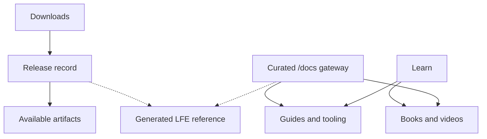

# LFE information architecture and content proposal

**Draft 0.1 — 8 October 2026**  
**For:** Duncan McGreggor and Robert Virding  
**Scope:** Group 4 in the [LFE work classification](lfe-work-classification.md)

LFE can combine Erlang's explicit release and documentation relationships with its own learning resources, examples, and distinctive Lisp/BEAM identity. The proposed site gives readers clear entrances for learning, reference, acquisition, and participation, while preserving useful books, talks, and historical links.

The central recommendation is a compact navigation with **Learn, Docs, Community, Blog, and About**, plus a prominent **Download** action. Books and Videos retain distinct catalogue pages, with direct entrances from Learn, Home, and the footer. The existing Use material supplies much of the curated Docs gateway.

**Established boundary:** `/docs` is the hand-curated documentation page. It will link to Robert's generated LFE documentation when that is available. Its format is anticipated to be ExDoc, but the architecture does not depend on that being confirmed. The generated documentation's location is a low-impact future choice; updating its link will not require changing the site's main hierarchy.

The proposals below are reviewable choices for the site and content. Compatibility promises, branch conventions, artifact production, and the visual design system remain in their respective work groups.

## 1 Inputs and governing choices

| Input | Implication for this proposal |
|---|---|
| Erlang release records join identity, changes, artifacts, and documentation | Give LFE release information a stable destination with those relationships |
| LFE already separates learning from practical reference | Preserve the distinction and make the reference entrance explicit |
| Four promoted project links failed in the LFE investigation | Every project entrance needs a verified destination that completes the task |
| Setup and older documentation mix different version eras | Show applicability where readers choose a resource |
| Books expose source and feedback routes | Preserve that provenance and carry resource status into repeated promotions |
| The blog has recent preservation and publishing work | Build on the existing archive and old-link handling |
| Duncan specifies a curated `/docs` gateway | Keep that URL's purpose stable as generated reference evolves |

Evidence: [Erlang investigation](erlang-org-ia-investigation.md), especially §§3–6 and 11–12; [LFE investigation](lfe-io-ia-investigation.md), especially §§3–8. The `/docs` boundary comes from Duncan's clarification on 8 October 2026.

The working principles are:

1. Each maintained explanation has a clear home. Other pages can introduce and link to it.
2. A navigation label describes the reader's task. Playful copy and imagery remain available within that structure.
3. A promoted link must deliver both a working destination and the help its label promises.
4. Publication date, completion, technical applicability, and maintenance status are distinct facts.
5. An old URL should continue to lead to its topic or explain where that topic went.
6. Unknown compatibility information stays visibly unknown; acquisition labels cannot create a support promise.

## 2 Proposed hierarchy and navigation

### Primary navigation

| Label | Proposed canonical route | Reader's question | Content owned here |
|---|---|---|---|
| Site identity | `/` | What is LFE, and where should I begin? | Introduction, examples, selected entrances |
| Learn | `/learn/` | How do I become productive in LFE? | Learning paths and a maintained getting started guide |
| Docs | `/docs/` | Where is the reference or guidance for this task? | Curated documentation gateway |
| Community | `/community/` | Where can I get help, contribute, or find projects? | Participation and ecosystem directory |
| Blog | `/blog/` | What has the project written or announced? | Dated technical writing and announcements |
| About | `/about/` | What is LFE's history and who develops it? | Background, identity, people, project provenance |
| Download | `/downloads/` | Which release or installation route should I choose? | Acquisition gateway and release selection |

Download is a prominent action linking to its gateway. Source archives remain available from that gateway and individual release records. This lets readers see context before making a version choice.

**Books:** `/books/` remains a distinct catalogue.  
**Videos:** `/videos/` becomes a distinct catalogue of talks and demonstrations.

Both appear in Learn's local navigation and in the global footer. Home also links directly to both. They are independently addressable pages even though the initial proposal does not put every catalogue in the primary navigation.

### Why this navigation

The proposal retains most familiar section names, introduces an explicit Docs entrance, and replaces direct archive selection in the Download menu with a gateway. It gives the small site room for richer catalogues without requiring a larger primary menu.

A flat alternative would add Books and Videos to the primary menu. That is reasonable if making those formats globally prominent is a project preference. The recommended initial choice is the compact menu above, with visibly labelled catalogue links in the three places readers already encounter learning material. Their URL and content roles survive either navigation choice.

### Local navigation

| Section | Proposed local destinations or headings |
|---|---|
| Learn | Start Here; Learn by Background; Books; Videos; Examples |
| Docs | Getting Started; Language Reference; Projects and Tooling; Erlang and OTP; Deployment; Older Material |
| Downloads | Latest Release; Installation Options; All Releases; Development |
| Community | Get Help; Contribute; Projects and Libraries; Channels |
| Blog | Existing Archive, Categories, Tags, and Authors |
| About | Language; History; People; Project Sources |

These entries can be headings and links on compact landing pages. They do not each require a new page. Split a subject into a separate page when it has substantive maintained content or needs a durable task-specific destination.

## 3 Home page organization

Home should introduce LFE and make a few useful actions easy to find. Detailed catalogues, installation instructions, and reference directories have dedicated homes.

| Order | Section | Content and action |
|---|---|---|
| 1 | LFE introduction | A short Lisp/BEAM description and a readable example; **Start Here** and **Download** actions |
| 2 | Language in practice | Retain the feature demonstrations; keep navigation among examples concise |
| 3 | Build with LFE | Scripts, libraries, OTP applications, and OTP releases; link each to verified instructions |
| 4 | Books and videos | A compact book selection and a few selected talks; explicit **All Books** and **All Videos** links |
| 5 | Community and current writing | A clear help/community entrance and a small selection of recent blog material |
| 6 | Footer | Direct routes to the principal tasks and catalogues |

With only four promoted books, Home can retain all four in a compact form if their descriptions remain useful. Videos can feature a small selection that represents introduction, practical work, and deeper exploration; the catalogue holds the complete curated list.

Retain the Lisp, alien, and retro-computing character. The copy immediately surrounding an action should explain the destination plainly. A humorous section title can be accompanied by a precise link such as “Create an OTP application.”

The four build actions should share a common editorial structure: what the project form is for, prerequisites, a runnable starting point, expected result, and the next step. An incomplete chapter must not be the only destination behind an action that promises a practical recipe.

## 4 Learning and curated documentation

### Learn owns the first success

Learn should begin with one maintained **Start Here** route. A proposed local home is `/learn/start/`; that route is a choice for review, not an existing page.

The getting started guide should take a reader through one recommended environment, a working REPL, one small expression or function, and a small saved program or project. It should provide the applicable LFE/OTP/tooling context, expected output, and a help link at the point a reader might get stuck.

The recommended environment requires maintainer validation. The IA can accommodate it now without assuming which combination will be selected.

After that common starting point, Learn offers paths based on what the reader already knows:

| Reader | Emphasis | Suitable next material |
|---|---|---|
| Erlang or another BEAM language user | Lisp syntax, macros, LFE conventions, interoperability | LFE Tutorial, language examples, language reference |
| Lisp user | Erlang data, processes, message passing, OTP | Tutorial, relevant manual chapters, practical OTP examples |
| Experienced programmer new to both | A gradual introduction to the language and its execution model | Start Here, tutorial, carefully selected talks |
| Returning LFE user | Changes and present setup | Release information, current setup, relevant reference |

These are paths through existing material, with short introductions where needed. They do not imply four new textbooks. Retain deeper Lisp/Erlang history as a later learning destination so the first practical route remains easy to follow.

### Docs owns the curated gateway

`/docs` has a stable public meaning: maintained pointers to LFE documentation and practical guidance. Use the visible title **Documentation** and the navigation label **Docs**.

| Gateway section | What it should offer | Canonical relationship |
|---|---|---|
| Getting started | Start Here, setup context, REPL help | Link to the maintained getting started guide and detailed REPL material |
| Language reference | Generated LFE reference when available; existing maintained reference meanwhile | Identify the reference's LFE version or development scope |
| Projects and tooling | Scripts, libraries, applications, releases, rebar3, editor support | Link to verified task guides and tooling authority |
| Erlang and OTP | LFE-specific explanations plus upstream reference | Make the upstream OTP documentation version clear |
| Deployment | Release building, deployment concepts, operational reading | Distinguish runnable instructions from background books |
| Older material | Historical references and replacements | Explain status before sending readers into an older generation |

Books, Videos, and relevant learning paths remain directly linked from Docs where useful. The generated reference and narrative teaching material have complementary roles.

### Generated documentation handoff

When Robert's reference is available, add a link with an explicit label such as **LFE language and library reference**. Accompany it with whatever version context the generator actually supplies. Its destination is stored as a maintained link rather than encoded into the gateway's identity.

Until then, the curated page should direct readers to the existing useful reference with an honest release or development label. No empty generated-reference page is needed.

The generated documentation's host, path, publication process, and eventual version navigation can be resolved later. `/docs` continues to serve the same role. This proposal creates no competing public `/doc` entrance and reserves no generated-output pathname.

### Content authority

| Information | Intended authority | Role of the curated site |
|---|---|---|
| LFE syntax and library behaviour | Reference maintained with the language, including Robert's generated output | Help readers choose the appropriate reference |
| First installation and first program | One maintained introductory route | Provide a dependable recommended starting point |
| Tool commands and build behaviour | Tooling documentation | Curate the entrance and supply LFE-specific context |
| OTP API behaviour | Erlang documentation for the relevant OTP version | Route outward with version context |
| LFE application of OTP concepts | Verified LFE examples and narrative guides | Connect explanation to runnable material |
| Historical accounts and experiments | Dated articles and preserved older resources | Explain historical status and present alternatives |

This division allows a fact to have one maintained explanation while appearing in several useful discovery routes. Consolidation means clarifying ownership and removing contradictory copies; it does not require moving every book or guide onto lfe.io.

## 5 Downloads and release relationships

### Downloads gateway

The gateway should answer three questions in order: what is the latest published release, how can I obtain or use it, and where can I find another release or development source?

Use **Latest published release** as a factual label. Use **Recommended setup** only for a maintainer-approved environment. These labels can refer to different things and should be explained if they do.

| Gateway block | Contents |
|---|---|
| Latest published release | Exact LFE version, release date, changes link, available acquisition choices |
| Installation options | Source, project dependency/tooling, containers, or other genuinely available methods; link to maintained instructions |
| Other releases | A simple list or table linking to identifiable release records |
| Development | Development source and the scope of its documentation; clear separation from published releases |

A simple release list is sufficient initially. A relationship explorer or elaborate compatibility selector needs demonstrated demand and validated underlying data.

### Release record

Give each published release an independently addressable record. A candidate route is `/downloads/<release>/`; the exact route convention can be settled with release engineering.

| Information | Reader value | Boundary |
|---|---|---|
| Exact LFE release and date | Establishes identity and chronology | Factual release metadata |
| Source tag and original release record | Connects the site to provenance | Reuse authoritative upstream information |
| Changes and relevant caveats | Helps a user decide whether to adopt it | Summarize or link; avoid conflicting duplicate notes |
| Available acquisition options | Makes the chosen release obtainable | List only artifacts/methods actually available |
| LFE/OTP context | Helps a user choose a suitable environment | Depends on validated compatibility information |
| Installation guidance | Connects selection to a successful setup | Preserve the selected release context |
| Applicable documentation | Connects the release to reference and teaching material | State whether the collection is exact, broader, or moving |

Older releases can have small records linking to GitHub and contextual material. They do not all need retrospective long-form release essays.

### Relationships that should survive navigation changes

Dashed links become available when there is a suitable generated reference destination. The relationship is useful now; its future URL need not be selected now.

### Version context

An LFE source release, a precompiled artifact, a build environment, a supported runtime combination, and a documentation collection describe different things. Keep each claim attached to the thing it describes.

For example, if a reference covers several LFE releases, its link should explain that scope. If a source archive has no associated generated reference, retain its provenance and link to applicable maintained guidance where available. Do not silently substitute current documentation and imply it describes the older release exactly.

The compatibility and release-engineering work groups supply the technical values. This proposal defines where readers encounter them and how the surrounding content should interpret them.

## 6 Books Videos Community and Blog

### Books catalogue

Retain the four current book identities and their published destinations. Improve the catalogue's ability to help readers choose:

| Book | Proposed catalogue description and treatment |
|---|---|
| LFE Machine Manual | Broad narrative manual; display verified readiness/applicability and direct readers to useful completed parts |
| LFE Tutorial | Language introduction; align its setup entrance with maintained present guidance |
| Casting SPELs in LFE | Project-based learning; describe prerequisites and the relevant environment after review |
| SICP LFE edition | Computer science exploration; make partial completion and version context easy to see |

Each entry should include purpose, author attribution, published destination, completion/applicability notes, source, and feedback. Put “Read” first; contribution links remain available.

Keep the superseded standalone books in an **Older editions and incorporated material** section, with links to their verified successor material. The source archive can remain discoverable without suggesting that the old book is the current starting point.

### Videos catalogue

Create one curated catalogue using the existing talks as its initial content. Separate introductory talks, practical demonstrations, and deeper language/BEAM topics with simple headings.

For each video, retain the title, presenter, event/date, watch destination, and a short topic description. Add version context when it matters and is known. Duration and channel links are useful when available, but missing optional metadata should not block listing a valuable talk.

A historical talk can remain valuable for ideas and language context. Flag dated tooling examples where review establishes that limitation. Community may link to channels, while the catalogue helps readers choose an individual talk.

### Community directory

Lead with **Get Help**, giving each channel's destination and scope. Recommend a primary starting channel only after maintainer confirmation; listing alone does not establish activity or response expectations.

Then provide **Contribute**, **Projects and Libraries**, and the broader **Channels** directory. Contribution routes should distinguish language/tooling, website, documentation/books, and writing/talks. Existing source and feedback links supply many of these destinations.

Replace the Social/Traditional Media distinction with reader tasks and recognisable resource types. Projects and Libraries should identify what an organization or project offers, with a current/historical/experimental description where established. A repository name alone is a weak explanation of what someone should try.

### Blog and About

Keep the blog's dated article URLs and existing Archive, Categories, Tags, and Authors entrances. Announcements can remain in the blog; a separate News section is not justified by the present content alone.

Continue the existing version-context work. Review related tags for consolidation while retaining topic access through old tag URLs. An old article's original publication date should remain intact; substantive updates can carry a separate review/update date.

About retains language background, history, Robert's creator story, and contributor provenance. Make present maintainer and contribution entrances clear without displacing the historical account. Detailed heritage reading can be shared with Learn through links.

## 7 Content disposition and existing URLs

This table assigns proposed treatment to discovered content families. It does not classify every uninspected chapter or authorize deletion.

| Existing material | Proposed treatment | Destination or relationship |
|---|---|---|
| Home identity and language examples | Retain; edit for clarity and verified applicability | Home |
| Four Home build actions | Repair and reconnect to verified instructions | Docs projects/tooling destinations |
| Learn progression | Retain and reorganize around first success and reader background | Learn |
| Use reference and practical directory | Consolidate into the curated gateway | `/docs/` |
| Existing `/use/` URL | Preserve as an entrance to its successor | Targeted redirect to Docs with reviewed topic/fragment handling |
| Header source ZIP choices | Retain acquisition choices inside a contextual gateway | Downloads and release records |
| Books catalogue | Retain and enrich resource descriptions | `/books/` |
| Superseded standalone books | Remove from current recommendations; preserve context and successors | Books older-material section |
| Featured videos and channel links | Retain; consolidate individual talks into a catalogue | `/videos/`; Community for channels |
| Current manual setup and tutorial installation instructions | Reconcile maintained starting guidance and version notes | Start Here plus the authoritative detailed instructions |
| Heading-only manual destinations | Verify content in the source and rendered page before further promotion | Promote useful content; supply another route with complete instructions if needed |
| Legacy `docs.lfe.io/current/` | Preserve valuable material with explicit historical context and replacements | Legacy entrance plus relevant curated pointers |
| Legacy `docs.lfe.io/dev/` | Retire unfinished placeholder navigation from active recommendations | Preserve useful content separately; connect meaningful old routes to replacements |
| Old `/reference/...` project URLs | Inventory and map by project type | Direct successors for script/library/application/release tasks |
| Old book/reference service links | Verify individually and record useful successors | Published book or reference destinations |
| Blog articles and old-domain entrances | Preserve topic identity and dated context | Existing canonical article routes |
| Overlapping blog tags | Consolidate discovery vocabulary where useful | Existing topic routes retain access |
| Community organizations | Retain after purpose/status review | Community project directory |
| About and heritage material | Retain; connect related reading | About and deeper Learn paths |

The four known broken project routes should lead to their corresponding task instructions. A general homepage fallback would discard the reader's intention.

For a removed page, distinguish three cases: a true successor, valuable historical material, or a placeholder with no substantive content. Use a successor link/redirect for the first, a contextual archive for the second, and an explanation or relevant alternative for the third.

Before a migration, record each old path and any externally used anchors, its topic, proposed treatment, successor, and verification result. Fragment behaviour and complete legacy coverage still need checking. Preserve the existing investigations as dated evidence rather than rewriting their observations to describe the proposed site.

## 8 Shared facts and editorial ownership

Keep the site small enough to maintain. Repeated promotions can share basic resource metadata while their surrounding prose stays appropriate to the page.

| Shared fact | Places that should use it | Reason |
|---|---|---|
| Latest published release identity | Downloads, release promotions, relevant notices | Prevent stale “current” copies |
| Validated recommended environment | Start Here, relevant Downloads guidance | Keep setup claims coherent |
| Resource title, destination, and attribution | Home, Learn, Docs, Books, Videos | Keep the promoted item identifiable |
| Completion and maintenance context | Catalogue and major promotions | Let readers choose knowingly |
| Version applicability and review context | Technical guides, articles, reference links | Distinguish a current recommendation from historical usefulness |
| Successor or archive relationship | Old entrances and catalogues | Preserve a useful path through change |
| Generated reference destination | Docs and applicable release records | Allow Robert's future publication location to change cheaply |

These are editorial relationships, not a new schema or database requirement. The existing shared configuration and content data are plausible starting points; their exact implementation belongs to later work.

Designate a maintained home for each recurring fact. Content owners should be apparent from the existing language, tooling, book, and website sources. A release changes acquisition/version facts; an article's publication alone should not reset its technical review status.

Use plain context such as **In progress**, **Written for LFE …**, **Historical**, or **Replaced by …** when it tells the reader something verified. Avoid a generic “supported” badge that merges completeness, currency, and compatibility.

## 9 Reader journeys and review checks

| Task | Proposed route | What a successful route delivers |
|---|---|---|
| Try LFE | Home → Start Here | A validated environment and a first working result |
| Learn with a book | Learn or Home → Books → chosen book | Clear audience, readiness, and applicability |
| Learn with a talk | Learn or Home → Videos → chosen talk | Topic, presenter/date, and a working watch link |
| Look up LFE behaviour | Docs → appropriate reference | Version/development context and the requested definition |
| Create a project | Home or Docs → project-type instructions | A runnable starting point and expected result |
| Choose a release | Download → Downloads → release record | Identity, changes, available acquisition, and applicable guidance |
| Use OTP from LFE | Docs → LFE explanation and relevant OTP reference | LFE usage plus upstream behaviour in the right version context |
| Get help or contribute | Community → task-specific destination | A clear channel or contribution route |
| Follow an old link | Old path → successor or contextual archive | Preserved topic and an understandable next step |

Before publishing changes, verify each promoted journey through its actual endpoint. For runnable guides, use the stated environment and check the expected result. For catalogues, verify resource identity as well as link response.

Test the Learn/Docs distinction with representative readers using tasks such as “get a REPL running,” “find the language reference,” “create an OTP application,” and “find a video introduction.” If readers routinely choose the wrong entrance, revise labels or placement. Task success is more informative than whether the sitemap looks orderly.

Search should describe its coverage honestly. A site search over lfe.io should not imply that it includes externally hosted books or generated reference unless it does. Those destinations can offer their own search with clear handoffs.

## 10 Review decisions and dependencies

| Choice | Status in this draft | What would change it |
|---|---|---|
| `/docs` is the curated gateway | Established by Duncan | Explicit later project decision |
| Generated LFE reference is linked from Docs | Established direction | Robert's publication readiness and available context |
| Generated format/location | Future low-impact detail | Confirmed generator and publication destination; no prerequisite for this draft |
| Learn and Docs have separate roles | Recommended | Reader testing or a different project preference |
| Books and Videos retain distinct catalogue pages | Recommended | Catalogue/navigation review |
| Five section links plus Download action | Recommended | Preference for a flatter menu or task-test evidence |
| Use content consolidates into Docs | Recommended | Review of exact content and old entrances |
| Downloads becomes a contextual gateway | Recommended | Review of acquisition needs and release facts |
| Release records connect identity, acquisition, and reference | Recommended | Release engineering supplies authoritative records and available relationships |
| Compatibility/support values | Supplied by work group 2 | Maintainer policy and validation evidence |
| Artifact and branch conventions | Supplied by work group 3 | Release engineering decisions |
| Visual system and presentation details | Parallel work group 5 | Existing design-system assessment and later choices |

The immediate review is architectural: whether these page roles and routes fit the intended LFE experience. The most useful next decisions are the primary navigation, the home-page emphasis, and the maintained getting started guide. Each can be discussed without fixing Robert's future generated-documentation URL.

## 11 Evidence references

| Reference | Use in this proposal |
|---|---|
| [LFE work classification](lfe-work-classification.md), group 4 | Scope; adjacent groups retain policy, engineering, design, and validation responsibilities |
| [erlang.org IA investigation](erlang-org-ia-investigation.md), §§3–6, 10–12 | Gateway roles, release relationships, documentation identity, and preservation lessons |
| [lfe.io IA investigation](lfe-io-ia-investigation.md), §§3–8 | Existing hierarchy, practical link failures, version seams, books, blog, and legacy material |
| Duncan's clarification, 8 October 2026 | Curated `/docs`; Robert's generated reference as a later link; format/location not a blocker |

The investigations contain the primary-source registers and their retrieval qualifications. This draft uses their recorded observations to propose a structure; tentative chapter completeness and unvalidated compatibility claims retain their original limits.
